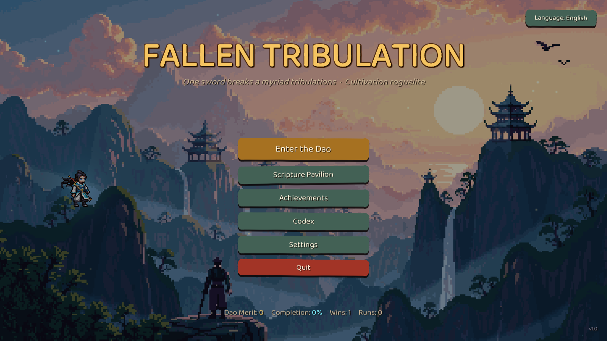
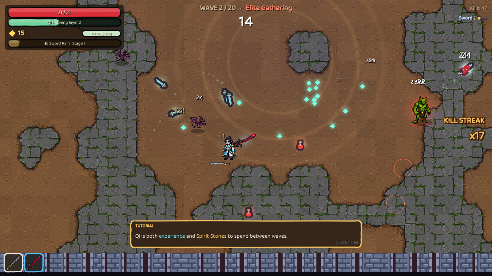
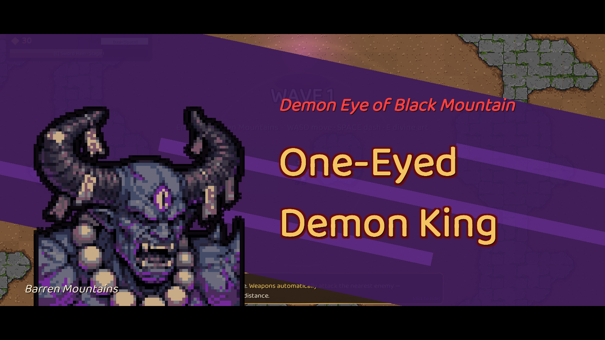
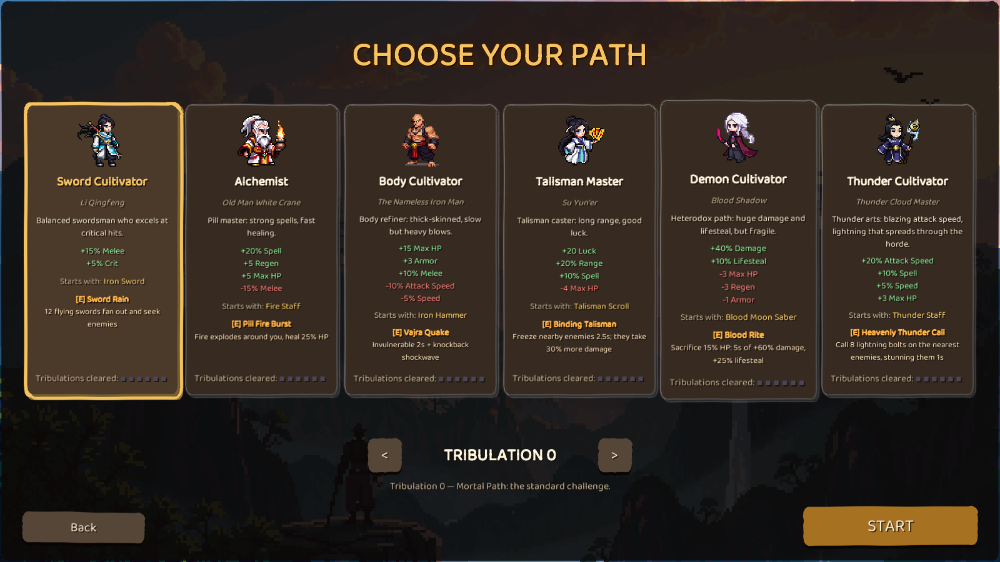
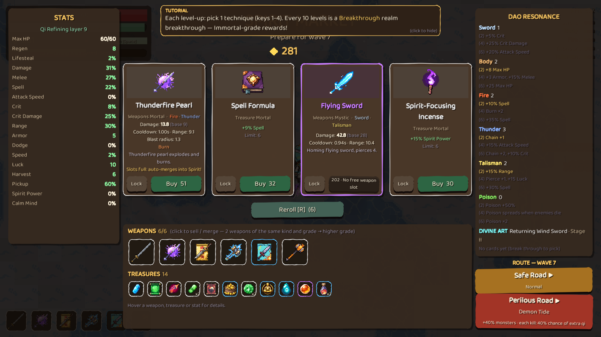
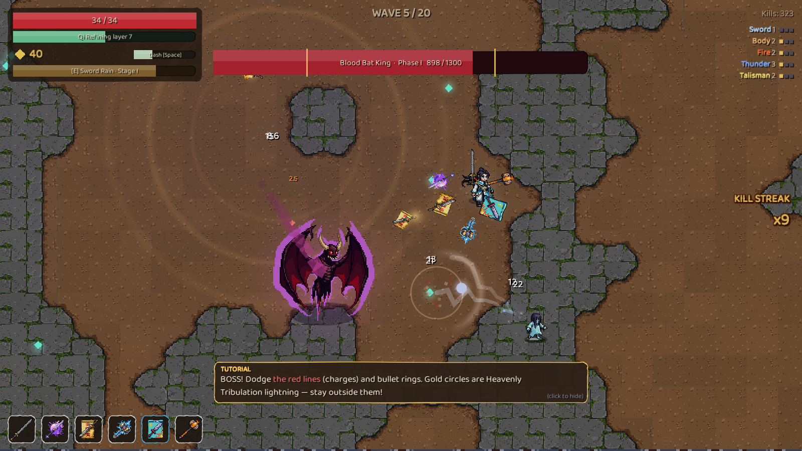

# Fallen Tribulation (Lục Đạo Đọa Kiếp)

## Play
Download the latest zip from the **Releases** page, unzip, run `FallenTribulation.exe` (Windows 64-bit). The game starts in a 1600x900 window; F11 toggles fullscreen.
Android (8.0+, ARM64): install `FallenTribulation-v1.0-demo-android.apk` from the same release. Also on itch.io: https://youngboi03.itch.io/fallen-tribulation
It speaks **English, Vietnamese and Chinese** (button at the top right of the menu; it follows your system language on first launch). A short tutorial appears the first time you play.

| Key | Action |
|---|---|
| WASD / arrows | Move (weapons aim and attack by themselves) |
| Space / Shift / right click | Dash (invulnerable while dashing) |
| E / J / left click | Divine Art: each character's signature skill |
| 1-4 | Pick an upgrade or event option |
| R | Reroll the shop |
| Esc / P | Pause |

Gamepad (Xbox layout) and touch controls are supported too. Volume, display, language and the full control list live in **Settings**.

The exe is not code-signed, so Windows SmartScreen may warn on first launch: choose "More info" then "Run anyway".

## Game loop
1. **Survive a wave** (20-60 s). Enemies are telegraphed with red circles. Kills drop Qi, which is both experience and the money you spend between waves.
2. **Between waves:** open chests, take a risky event, level up (choose 1 of 4 techniques), shop for weapons and treasures, then choose a safe or a perilous route.
3. **Boss every 5 waves**, with heavenly lightning that also hits enemies. Beat wave 20 to ascend.
4. Win or lose, you earn Dao Merit to buy permanent upgrades.

## Build
- Every weapon belongs to one or more Paths (Sword, Body, Fire, Thunder, Talisman, Poison); 2, 4 or 6 of the same Path unlock set bonuses.
- Two weapons of the same kind and grade merge into a higher grade.
- Joker-style treasures create combos, for example one that grows with the Spirit Stones you hold, or one that multiplies damage when you run five different Paths.
- 6 characters, 6 difficulty levels (Tribulations) each, 20 achievements, a codex, and a permanent upgrade tree. All of it feeds the completion % shown on the menu.

## Project notes
- Unity **6000.3.27f1**. There are no hand-built scenes or prefabs: the game builds itself from code at runtime (`Assets/Scripts`, with `Core/`, `Play/`, `UI/`, `Data/`, `Auto/`).
- Game content and balance live in `Assets/Scripts/Data/Content.cs` and `Events.cs`.
- Sound effects are designed from CC0 recordings (`tools/audio_gen.py design`), with some Kenney clips left. Menu, battle and climax music is AI-generated; boss-wave music is still synthesized in code (`Synth`).
- A self-playing bot (`-autotest`) and scenario tests (`-skilltest`) drive balance and regression checks: `bash tools/build_and_test.sh 3 -skilltest -only ""`.
- Store-readiness notes (input, saves, achievements abstraction): `docs/PORTING.md`.
- Vietnamese README: [README.vi.md](README.vi.md). Development story: [docs/DEVLOG.en.md](docs/DEVLOG.en.md) ([Tiếng Việt](docs/DEVLOG.vi.md)).

## Credits and licenses
- **Source code:** MIT, see `LICENSE`. Third-party assets keep their own licenses.
- **Character, enemy, boss, weapon/treasure icon and background art:** generated with PixelLab (AI pixel-art tool), then cleaned up and edited in Aseprite with a scripted clean-up and QA pipeline; the tool and prompt for each image are logged in `Assets/ThirdParty/PixelLab-Assets.md`.
- **Tiles and sound packs:** [Kenney](https://kenney.nl) (CC0): Tiny Dungeon, Impact Sounds, Interface Sounds, RPG Audio, Music Jingles. Licenses in `Assets/ThirdParty/`.
- **Sound effects:** recordings from [BigSoundBank](https://bigsoundbank.com/licenses.html) by Joseph Sardin and contributors (CC0) and OpenGameArt (CC0), listed in `Assets/ThirdParty/CC0-Sounds.md`.
- **Music:** generated with Stable Audio 3. Powered by Stability AI, see `Assets/ThirdParty/stability-NOTICE.txt`.
- **Spell effects:** rendered with [pixelfx](https://github.com/patch-gg/pixelfx) by Patch and Hugo Duprez (MIT), `Assets/ThirdParty/pixelfx-LICENSE.txt`; our top-down effects are in `tools/vfx/fx/`.
- **Fonts:** Baloo 2 by Ek Type (UI text), Comforter Brush by Robert Leuschke (Latin titles) and Zhi Mang Xing (Chinese titles), all SIL Open Font License 1.1 (`Assets/ThirdParty/*-OFL.txt`). Chinese body text uses an installed system font.
